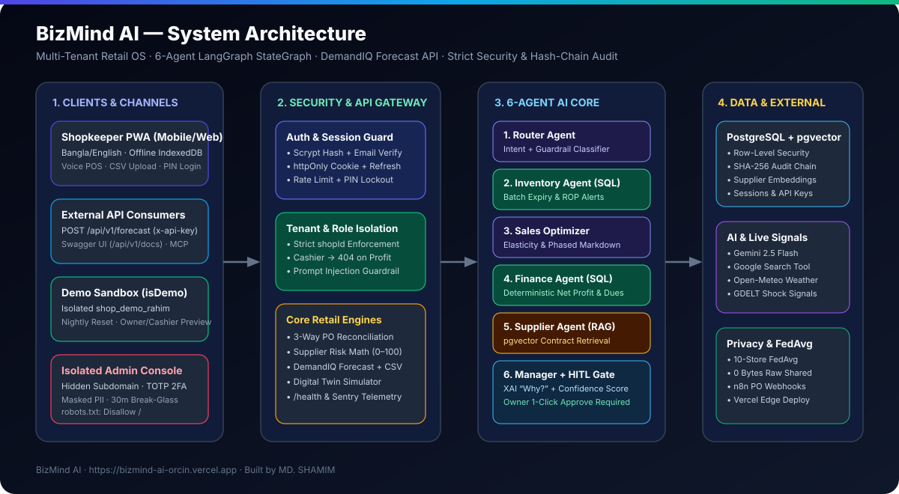

# BizMind AI — Multi-Agent Retail Intelligence for Small Shops in Bangladesh

> **“অপচয় কমায় · বাকি আদায় করে · লাভ বাড়ায়”**  
> *(Cuts expiry waste · Recovers credit dues · Grows verified net profit)*

[](https://bizmind-ai-orcin.vercel.app)
[](https://bizmind-ai-orcin.vercel.app/api/v1/docs)
[](https://bizmind-ai-orcin.vercel.app/health)

---

## 1. What is BizMind AI?

**BizMind AI** is a mobile-first, bilingual (Bangla + English) retail operating system and AI decision co-pilot built for neighborhood grocery shops (*মুদি দোকান*) in Bangladesh and designed to scale to multi-branch retail chains.

Traditional paper ledgers (*বাকির খাতা*) leave small shopkeepers blind to:
- **Expiring inventory batches** (e.g., 55 farm eggs expiring in 4 days before Eid),
- **Hidden supplier overcharges** (e.g., Miniket rice billed at ৳62/kg vs ৳58/kg PO), and
- **Silent stockouts** during rainstorms, price shocks, and religious festivals.

BizMind AI solves this with a **6-Agent LangGraph.js StateGraph** (deterministic SQL for financial math + `pgvector` RAG for supplier policies), **weather-aware demand forecasting**, **Bangla Voice-to-Action**, **Invoice OCR + 3-Way PO Reconciliation**, and strict **Human-in-the-Loop (HITL) owner approvals**.

---

## 2. Live Links & Demo Video

| Resource | URL |
|---|---|
| **Live Production App** | https://bizmind-ai-orcin.vercel.app |
| **Interactive Swagger / OpenAPI Docs** | https://bizmind-ai-orcin.vercel.app/api/v1/docs |
| **OpenAPI 3.1 JSON Spec** | https://bizmind-ai-orcin.vercel.app/api/v1/openapi.json |
| **Live Server Health Check** | https://bizmind-ai-orcin.vercel.app/health |
| **3-Minute Hackathon Demo Video** | `bizmind-ai-3min-demo.mp4` (YouTube link added upon upload) |
| **Backtest Methodology & Assumptions** | [`docs/backtest.md`](./docs/backtest.md) |

---

## 3. System Architecture



---

## 4. Honest Feature Status Matrix (Live vs. Sandbox/Simulated vs. Roadmap)

We believe judges and users deserve complete transparency about what runs live today versus what runs in sandbox or simulation mode:

| Capability | Status | Implementation Details |
|---|---|---|
| **Bilingual POS, Stock & Credit Ledger (PWA)** | ✅ **Live Working** | Full Bangla/English toggle, dark/light theme, offline IndexedDB queue (`sw.js`), mobile-first responsive UI |
| **Live AI Chat (Gemini 2.5 Flash + Google Search)** | ✅ **Live Working** | `/api/v1/public-ai/chat` connects to live Gemini 2.5 Flash + Search grounding when `GEMINI_API_KEY` is configured, with structured deterministic retail fallback |
| **6-Agent Trace + XAI ("কেন?") + Owner HITL** | ✅ **Live Working** | `/api/v1/ai/multi-agent-trace`, rule-based confidence scoring, spending cap, dry-run mode, and 1-click kill switch |
| **Tenant Isolation, Role Guards & Hash-Chain Audit** | ✅ **Live Working** | Server-side `shopId` scoping, Cashier `404` on profit endpoints, SHA-256 tamper-evident audit chain, automated test in `tests/tenant-isolation.test.ts` |
| **Email/Password Auth, Staff Invite & 4–6 Digit PIN** | ✅ **Live Working** | Scrypt salted password hashing, `httpOnly` cookie + refresh token, rate-limited PIN login, device session list & revoke |
| **Isolated Demo Mode & Hidden 2FA Admin Console** | ✅ **Live Working** | `DEMO_MODE` isolated demo shop (`isDemo: true`), zero Admin link in public UI, masked PII & 30-min read-only Break-Glass in `admin/index.html` |
| **External Forecast API (`POST /api/v1/forecast`) & CSV Upload** | ✅ **Live Working** | API Key header (`x-api-key`), Swagger UI (`/api/v1/docs`), and shopkeeper CSV sales upload (`/api/v1/forecast/csv`) |
| **DemandIQ 90-Day Backtest & 10-Store FedAvg** | 🧪 **Synthetic / Kaggle Schema** | Reproducible strict chronological 90-day holdout (`scripts/kaggle_demandiq_benchmark.py`); **not** live production store data yet. See [`docs/backtest.md`](./docs/backtest.md) |
| **Digital Twin What-If + Open-Meteo Live Weather** | ✅ **Live Weather + Sim Model** | Live Dhaka weather from Open-Meteo combined with explicit transparent elasticity assumptions |
| **Invoice OCR + 3-Way PO Reconciliation** | 🧪 **Sandbox / Deterministic Engine** | Deterministic 3-way PO vs Invoice vs Received reconciliation engine (`/api/v1/reconciliation/po-invoice`) with interactive sample chalan uploader |
| **bKash / Nagad / SSLCommerz Billing** | 🧪 **Sandbox Mode** | Interactive checkout simulator for Premium (`৳499/mo`); live merchant gateway activation requires trade license & merchant KYC |
| **Bangladesh Phone SMS OTP** | 🗓️ **Coming Soon** | Deferred due to BTRC Sender ID approval & SMS gateway cost; Email + Password + Staff PIN are live today |

---

## 5. Security, Auth & Privacy Design

1. **Zero Self-Selected Roles**: Shop owners sign up with email & password and automatically receive the `OWNER` role. There is no role dropdown on signup.
2. **Owner-Controlled Staff Invites & PIN Login**: Owners invite staff (`MANAGER`, `CASHIER`, `STOCK_KEEPER`) by invite link; staff set their own password and can use a rate-limited 4–6 digit PIN on shared shop devices.
3. **Separated Demo Environment**: Clicking **"Demo চালিয়ে দেখুন"** creates an isolated session tied exclusively to `shop_demo_rahim` (`isDemo: true`) with nightly reset (`scripts/reset-demo.ts`). Owner/Cashier preview switching is enabled **only** inside Demo mode.
4. **Hidden Admin & Scoped Support Privacy**: The Admin console (`admin/index.html`, `robots.txt: Disallow: /`) has no public links, requires TOTP 2FA, masks phone/email by default (`017****89`), never displays passwords, and requires a logged 30-minute read-only **Break-Glass** reason to view shop support data.

---

## 6. Quick Start (Run Locally)

```bash
# 1. Clone repository
git clone https://github.com/mdshamim-mern/bizmind-ai.git
cd bizmind-ai

# 2. Configure environment variables (NEVER commit .env)
cp .env.example .env

# 3. Install dependencies
npm install

# 4. Run automated Tenant Isolation & Security tests
npm test

# 5. Start development server
npm run dev
# App: http://localhost:3000
# Swagger API Docs: http://localhost:3000/api/v1/docs
# Health Check: http://localhost:3000/health
```

### Run DemandIQ Chronological Backtest
```bash
python3 scripts/kaggle_demandiq_benchmark.py
```

---

## 7. GitHub Repository About & Topics (Recommended)

- **Description**: `AI-powered bilingual retail OS & 6-Agent LangGraph co-pilot for Bangladeshi small shops — weather-aware demand forecasting, Bangla voice POS, invoice 3-way PO reconciliation, and strict tenant isolation.`
- **Website**: `https://bizmind-ai-orcin.vercel.app`
- **Topics**: `demand-forecasting`, `inventory`, `langgraph`, `bangladesh`, `multi-agent`, `retail-ai`, `pwa`, `typescript`, `openapi`

---

## 8. Creator & Contact

- **Developer**: MD. SHAMIM
- **Email**: `mdshamim.mern@gmail.com`
- **GitHub**: https://github.com/mdshamim-mern/bizmind-ai
- **LinkedIn**: https://www.linkedin.com/in/md-shamim471/
